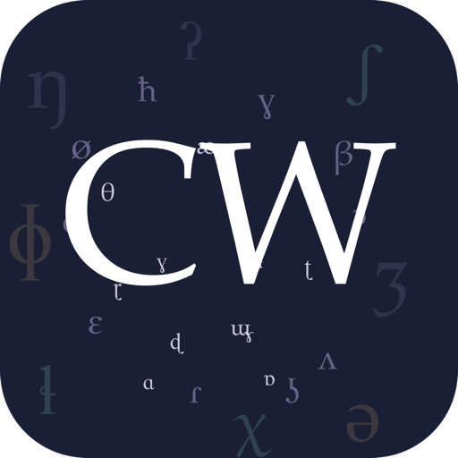

# Conlang Workbench



A workbench for designing constructed languages, from sounds to grammar to vocabulary. It runs in the browser with no server and no account, and each language is one readable JSON file on your computer.

## Features

### Phonology
- Phoneme inventory with an IPA chart and audio for each symbol
- Natural classes, including built-in `[geminate]` and `[long vowel]`
- Phonotactic constraints and sound rules, built with structured controls
- Word generator based on your phonotactics

### Grammar
- Parts of speech with their own dimensions, such as number or tense
- Inflections with paradigm tables, built from prefixes, suffixes, infixes, replacements, root templates, reduplication, elongation and irregular forms
- Constructions, such as `have` [`PERF`] + Verb (Past Participle), which the Scratchpad recognizes and glosses
- Typology settings, such as word order and alignment

### Lexicon
- Dictionary of roots, derived words and particles
- Derivations that follow their parent word and rule, so changing either updates every descendant
- Swadesh list and Conlanger's Thesaurus for finding gaps
- Anki export

### Also included
- Scratchpad for analyzing and glossing phrases
- Searchable linguistics glossary
- MCP tools that let an AI assistant read and edit a language file on your computer

## Getting started

Requires Node.js 20 or later.

```bash
git clone https://github.com/anonx3247/conlang.git
cd conlang/web
npm install
npm run dev          # http://localhost:5173
```

File → Open also accepts `.conlang` projects from the Flutter desktop app and converts them, leaving the original unchanged.

See [`web/README.md`](web/README.md) for testing, deployment, how derivation works, and the MCP setup.

## License

MIT, see [LICENSE](LICENSE). IPA audio credits are in [`web/public/AUDIO_CREDITS.md`](web/public/AUDIO_CREDITS.md).

---

**Note:** this is a TypeScript rewrite of the original Conlang Workbench, which was made in Flutter. The Flutter code is still available in the git history, at commit [`8924827`](https://github.com/anonx3247/conlang/tree/8924827).
